# Eleven Cards

Home Assistant dashboard cards for energy, sensor history, calendars, weather, vehicles and everyday controls.

## Shared card background

Production card types have a **Card background / Kaartachtergrond** section in their visual editor. The separately identified Material House pilot retains its own approved editor and appearance controls; the shared `card_background` contract does not apply to that pilot. Choose Aurora sky, Silk Flow, Atmospheric flow, Ink bloom or Holographic grid; theme accent, up to three custom colours or the card's status colour; transparency; animation; and coverage of the whole card or the top X pixels. A top section fades at its lower edge, and decoration stays within the theme's rounded card corners. Decorative backgrounds are off by default; the normal Home Assistant theme surface is unchanged. Enabling a background uses Atmospheric flow over the top 240 px with 65% transparency unless configured otherwise. Explicit existing background YAML stays usable. When enabled, decoration is excluded from graph surfaces, including their axes, and follows layout changes without changing the graph's theme surface.

Add the same object to any card configuration:

```yaml
card_background:
  variant: isobars # aurora, ribbon, ink-bloom, hologram
  colorMode: accent # custom or dynamic
  colors: ['#4db6ac', '#7287ed', '#c77dbd'] # used in custom mode
  transparency: 65
  coverage: header # card for the full surface
  height: 240
  animated: true
```

Use `card_background: false` to turn it off. Dynamic colours use the calling card's status tone where available and otherwise fall back to the Home Assistant accent. Animation respects reduced motion and pauses outside the viewport. See the [shared component documentation](shared/README.md#animated-card-background) and the [interactive overview](review/index.html).


## Cards

| Card | What it shows | Configuration |
| --- | --- | --- |
| **Energy** | Import and export prices, favorable periods and an optional grid-import energy overlay. | [Energy documentation](cards/dynamic-energy-price-card/README.md) |
| **History** | Recorded values from 1–8 numeric sensors, with an independent y-axis per unit. | [History documentation](cards/history-graph-card/README.md) |
| **Timeline** | State history for entities such as doors, switches and people. | [Timeline documentation](cards/timeline-card/README.md) |
| **Overview** | Current sensor values, sparklines and change since period start. | [Overview documentation](cards/overview-card/README.md) |
| **Bar Chart** | Vertical grouped or stacked sensor-history bars, based on History. | [Bar Chart documentation](cards/bar-chart/README.md) |
| **Heatmap (beta)** | Sensor averages or consumption grouped by hour, day, week or month. | [Heatmap documentation](cards/heatmap-card/README.md) |
| **Car (beta)** | Vehicle image, percentage and custom readings, with optional EVCC charging integration and selectable tabs. | [Car documentation](cards/car-card/README.md) |
| **Weather (beta)** | Compact current weather and a short hourly or daily forecast, with state-colored artwork. | [Weather documentation](cards/weather-card/README.md) |
| **Energy Flow (beta)** | Solar, grid and home distribution using Home Assistant Energy configuration and Recorder, with live/history buttons. | [Energy Flow documentation](cards/energy-flow-card/README.md) |
| **Camera (beta)** | Camera feeds, alarm controls, doors/windows and paginated activity. | [Camera documentation](cards/camera-card/README.md) |
| **Camera Viewer (beta)** | Camera selected in a linked Camera card on the same dashboard page. | [Camera Viewer documentation](cards/camera-card/README.md#separate-camera-viewer) |
| **Media Player (beta)** | Radio favourites, playback controls and five layouts, including Studio and Horizontal. | [Media Player documentation](cards/media-player-card/README.md) |
| **Calendar (beta)** | Calendar events in a day list, day columns or month view, with optional weather. | [Calendar documentation](cards/calendar-card/README.md) |
| **House (beta)** | Configurable transparent house rendering, lighting, people and optional current-weather decoration. | [House documentation](cards/house-card/README.md) |
| **Shopping** | Any to-do list, with non-blocking additions, integrated saving/retry rows and provider-driven editing. | [Shopping documentation](cards/shopping-card/README.md) |
| **Control Pad** | Scene and script buttons, with optional confirmation. | [Control Pad documentation](cards/home-controls/README.md) |
| **Controls** | Capability-aware thermostat, light, cover, fan and numeric controls. | [Controls documentation](cards/home-controls/README.md) |
| **Waste** | Upcoming collections from existing sensors or calendars. | [Waste documentation](cards/home-controls/README.md) |
| **Appliance Planner** | Tariff-based appliance run advice, optionally linked to a separate integration. | [Planner documentation](cards/appliance-planner/README.md) |
| **Room** | Room scenes, lighting, temperature, humidity and navigation. | [Room documentation](cards/room-card/README.md) |
| **Scene Engine** | Effective scene requests, request details and confirmed reset. | [Scene Engine documentation](cards/scene-engine-card/frontend/README.md) |
| **Material House (approved pilot)** | The approved theme-following House pilot, kept separate from existing House. | [Pilot requirements](#material-house-pilot) |


All nineteen card types are included in the collection, with configuration editors and Home Assistant light/dark theme support. Packaging does not change their existing appearance or settings. House currently retains its approved Dutch chrome; the other cards follow Dutch/English frontend language. Energy, History, Timeline and Bar Chart support synchronized hover across cards. History, Bar Chart and Timeline also share a compact period picker and a single group for previous/next, Now and zoom controls in the header, with rolling windows and local calendar days, weeks, months, quarters and years. These three cards also indicate zoom, support isolating one entity and provide an information icon beside History with compact per-sensor source and unit information. History and Bar Chart include per-sensor min/max/average for the viewed range; Delta Bar Chart adds sums in the same popup. Calendar list and column views reuse the shared period popup for day counts, calendar periods and custom ranges, while Month view offers only previous month, Now and next month. Calendar keeps its own date navigation and Home Assistant timezone; it does not join graph timeframe synchronization.

Car combines the vehicle and EVCC cards. Enable EVCC integration to show charging data and choose the Controls, Session and EVCC tabs; disable it to choose your own percentage and three entity readings. Compact changes density independently of visible tabs. The standalone EVCC card has been removed. Migrate existing `custom:eleven-evcc-card` dashboards to `custom:eleven-car-card` with `evcc_enabled: true`; retain the entity mappings and other settings. The Climate prototype has also been removed.

The cards use existing Home Assistant data. They do not provide tariffs or create sensors. Car with EVCC enabled can change charging settings through Home Assistant. See each card's documentation for its sensor requirements and configuration options.

Weather, Car and Energy Flow share one header fade that ends before tab content, including compact layouts.

## Standalone alternatives and integration requirements

The collection includes twenty-two card types. These standalone modules remain available for existing installations; they are alternatives, not additional resources required by HACS. Building this source tree does not itself publish a release or update an installed dashboard.

| Card | What it shows | Resource and documentation |
| --- | --- | --- |
| **Control Pad** | Buttons for scenes and scripts, with optional confirmation. | [Standalone controls](cards/home-controls/README.md) - `cards/home-controls/dist/eleven-home-controls-card.js` |
| **Controls** | Thermostat and light controls. | [Standalone controls](cards/home-controls/README.md) - same module as Control Pad |
| **Waste** | Upcoming waste collection dates. | [Standalone controls](cards/home-controls/README.md) - same module as Control Pad |
| **Room** | Room scenes, lighting, temperature, humidity and dashboard navigation. | [Room documentation](cards/room-card/README.md) - `cards/room-card/dist/eleven-room-card.js` |
| **Appliance Planner** | Tariff-based advice for an appliance run before a deadline. | [Planner documentation](cards/appliance-planner/README.md) - `cards/appliance-planner/dist/eleven-appliance-planner.js` |
| **Scene Engine** | Effective scene request, active requests and confirmed reset. | [Scene Engine documentation](cards/scene-engine-card/frontend/README.md) - `cards/scene-engine-card/dist/eleven-scene-engine-card.js` |
| **Material House (pilot)** | Approved pilot, not a replacement for House. | `experiments/material-house/dist/material-house.js` (packaged by the root build) |

Bundling frontend code does **not** install backend integrations, create entities, tariffs, house images or manifests. Control Pad and Controls use existing entities and can call their Home Assistant services. Waste needs configured sensor/calendar data, not a mandatory custom integration. Appliance Planner standalone advice needs valid tariffs and program duration/energy; linking existing persistent plans requires the separately installed Appliance Planner integration with protocol version 2. Scene Engine requires its separate integration, an engine entity and the explicitly selected reset button from the same engine; reset still requires confirmation. These integrations are not included in the HACS dashboard resource.

### Material House pilot

Use `custom:eleven-material-house` for the approved pilot and `custom:eleven-house-card` for existing House. Existing House and `eleven-house-styled-card` aliases are preserved; no saved configuration is automatically migrated or replaced. The pilot retains its own Dutch editor/chrome and requires a compatible transparent house image manifest (`manifest`), plus the existing entity bindings for interactive lighting. It does not render or generate house assets, install a house-render backend, or download household assets as part of this bundle. See the [House manifest requirements](cards/house-card/README.md).

The pilot closure is rebuilt from provenance-checked upstream inputs by `experiments/material-house/build.py`. The root collection packager suppresses internal baseline registrations/picker entries and applies a repeat-load boundary to the generated standalone pilot as well as the collection. Its approved rendering, theme behavior and source dependency closure are otherwise unchanged.

## Card previews

Current card screenshots with the optional Eleven Material light theme and fictional data. They show the current branch, including local betas; they do not indicate a published release or design approval. Car with EVCC is shown separately as an additional configuration of Car. Appearance follows your Home Assistant theme.

### Energy

Follow electricity import and export prices, find inexpensive periods and compare them with an optional grid-import energy overlay. [Configuration and options](cards/dynamic-energy-price-card/README.md).

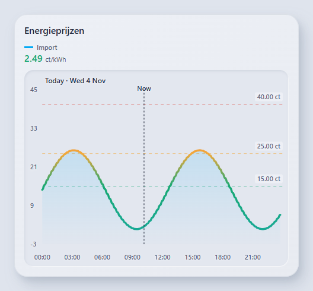

### History

Compare recorded values from up to eight sensors. Different units keep their own axes; the shared period picker, zoom and legend help inspect a particular interval. [Configuration and options](cards/history-graph-card/README.md).

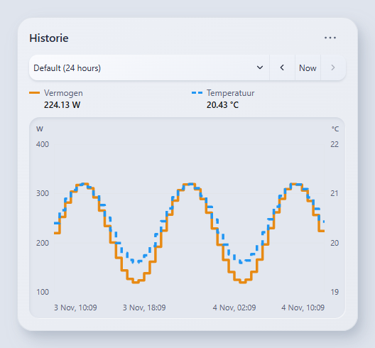

### Timeline

See when doors, switches, people or other entities changed state. Coloured intervals, duration summaries and period navigation make recurring patterns easier to spot. [Configuration and options](cards/timeline-card/README.md).

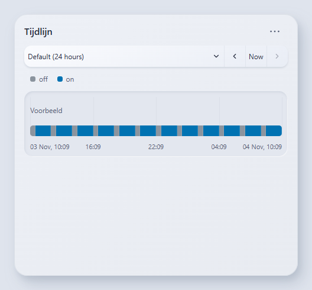

### Overview

Keep current sensor values, their recent sparklines and changes since the start of the period together in a compact overview. [Configuration and options](cards/overview-card/README.md).

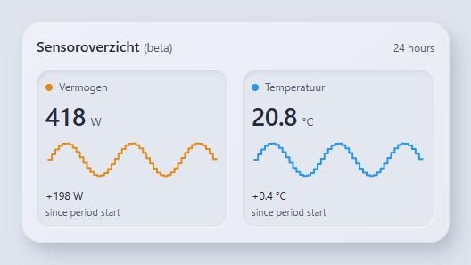

### Bar Chart

Compare sensor history in grouped or stacked bars. Use periods and aggregation to inspect measurements or consumption totals. [Configuration and options](cards/bar-chart/README.md).

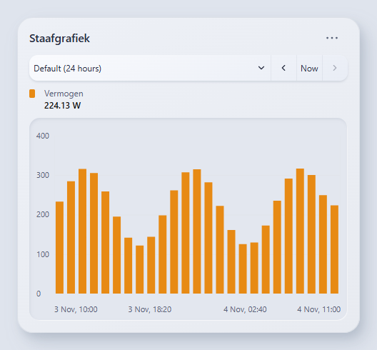

### Heatmap

Find daily and weekly patterns in sensor measurements or consumption. A full-width colour scale explains the intensity of the matrix. [Configuration and options](cards/heatmap-card/README.md).

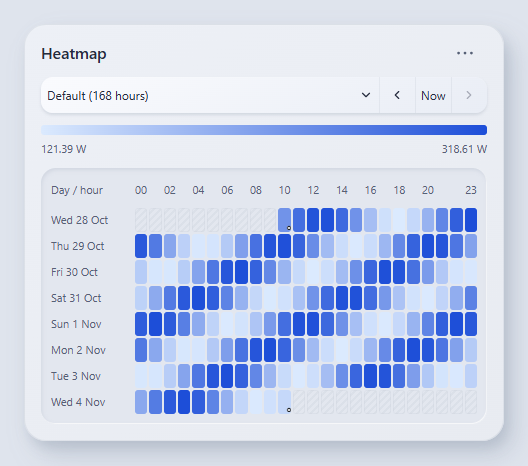

### Calendar

Show appointments as a day list, day columns or a month grid. Recessed day surfaces, softly tinted appointments and subtle shadows match the shared styling. Past month dates are greyed out; today has an accent-coloured date and a short underline. [Configuration and options](cards/calendar-card/README.md).

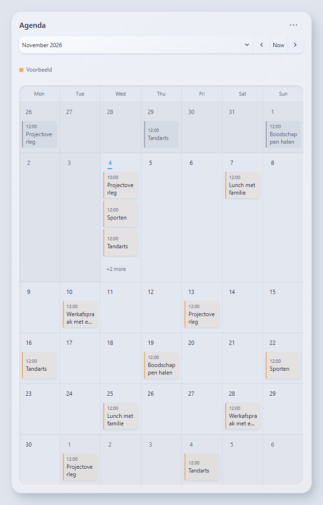

### Weather

Combine current weather, temperature and supporting readings with an hourly or daily forecast. Choose the visible readings and forecast tabs, or use a compact layout. [Configuration and options](cards/weather-card/README.md).

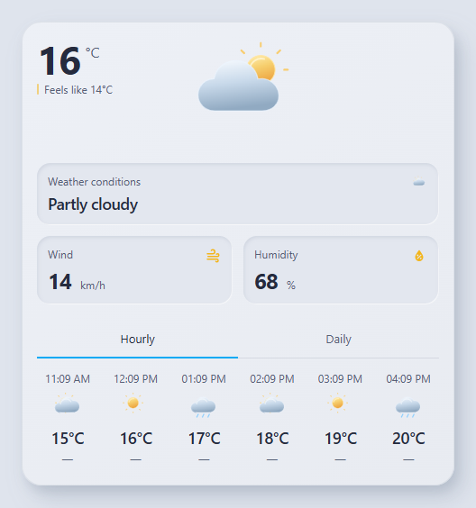

### Car

Show your vehicle image, battery percentage, range and custom readings such as status or odometer. Values come from the Home Assistant entities selected in the editor. [Configuration and options](cards/car-card/README.md).

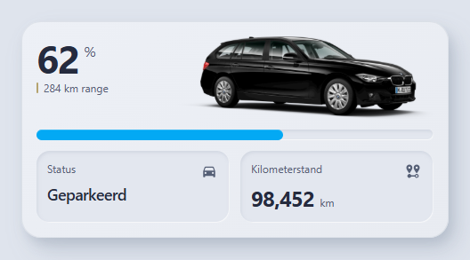

### Car with EVCC

Enable EVCC in the same Car card to add charging mode, power, target percentage and session details. This is a configuration of Car, not a separate card type. Charging controls operate through Home Assistant. [Configuration and options](cards/car-card/README.md).

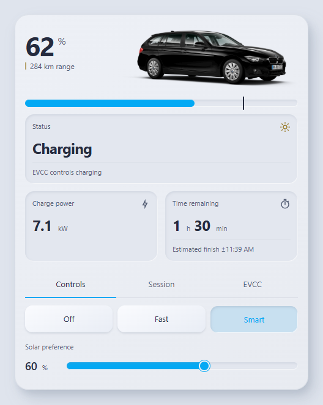

### Energy Flow

See solar generation, grid import/export and home consumption using the Home Assistant Energy configuration. Switch between current power and historical energy, and inspect solar, home or grid details. [Configuration and options](cards/energy-flow-card/README.md).

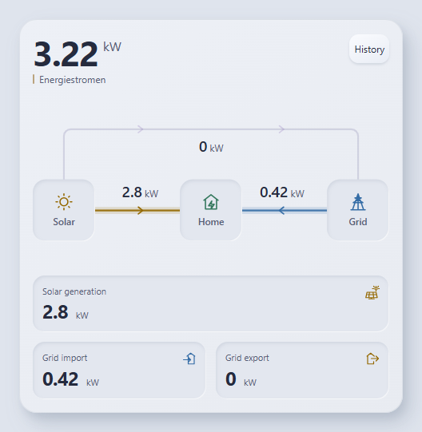

### House

Display your own transparent house render with lighting, presence and optional weather decoration. Supply a compatible image manifest; the card does not generate house models. This screenshot uses a generic synthetic scene. [Configuration and options](cards/house-card/README.md).

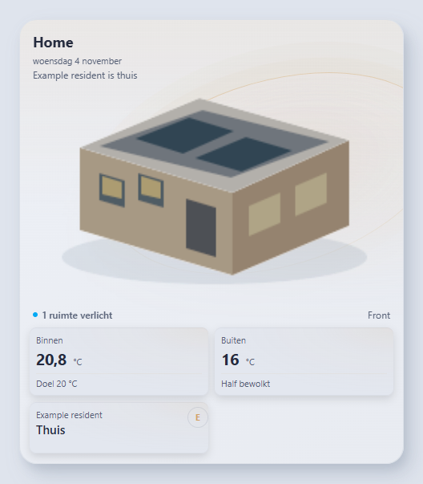

### Shopping

Use an existing Home Assistant to-do list for shopping or other tasks. Add items, mark them complete and edit supported fields, with saving and retry states kept inside the list. [Configuration and options](cards/shopping-card/README.md).

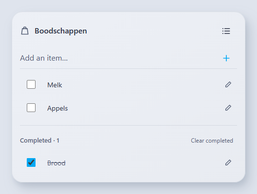

### Control Pad

Run selected scenes and scripts from a responsive button grid. Choose the column limit, labels and icons, and enable confirmation when appropriate. [Configuration and options](cards/home-controls/README.md).

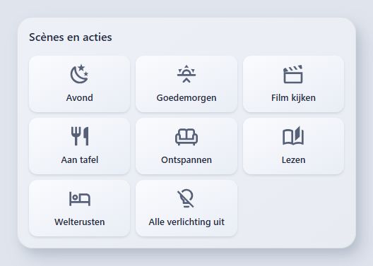

### Controls

Bring thermostat and light controls together in a small card. The available controls follow each entity's supported Home Assistant features. [Configuration and options](cards/home-controls/README.md).

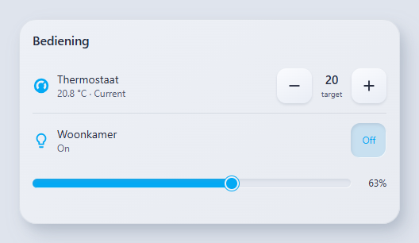

### Waste

Show the next collection dates from configured waste sensors, with separate names and colours for each waste type. [Configuration and options](cards/home-controls/README.md).

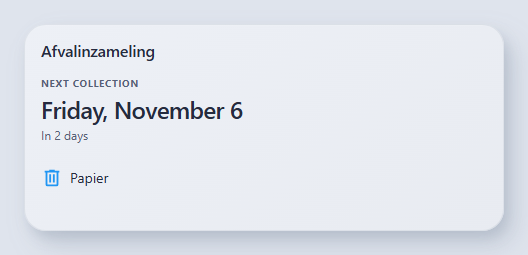

### Room

Summarise a room with compact scene controls, light state, temperature and optional humidity. Open the room dashboard from its name or the primary light's more-info dialog from the light button. [Configuration and options](cards/room-card/README.md).

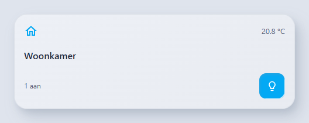

### Appliance Planner

Compare available appliance programs and find an inexpensive uninterrupted run before a chosen deadline. Advice uses configured durations, energy use and tariffs; standalone advice does not start an appliance. [Configuration and options](cards/appliance-planner/README.md).

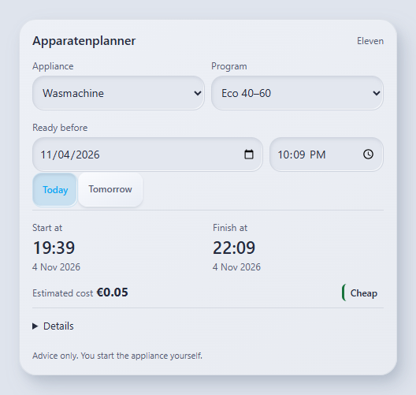

### Scene Engine

Inspect the effective scene request, its priority and the number of active requests from a Scene Engine entity. An optional reset button exposes the configured Home Assistant reset action. [Configuration and options](cards/scene-engine-card/frontend/README.md).

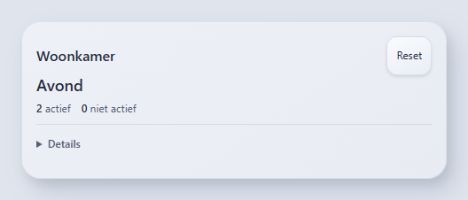

## Synchronize timeframes (local version)

All six visual editors expose **Synchronize timeframe** (off by default) and **Synchronization group**. Enable it on each card to link, using the same group key:

```yaml
sync_timeframe: true
hover_sync_group: energy
```

Hover and timeframe synchronization use the same `hover_sync_group` setting, labeled Synchronization group. Each synchronization can be enabled separately. Legacy `timeframe_sync_group` is accepted when `hover_sync_group` is absent.

The compact timeframe popup has **Last**, **Calendar** and **Custom range** tabs, with **Default** always available above them. It opens the category of the selected range and keeps drafts when switching tabs or refreshing.

Open the **Custom range** tab to enter start and end dates and times in the Home Assistant timezone (up to 366 days). The chosen range stays fixed and can be shared with the group. Previous/next move by the range duration; Now shows that duration ending at the current time. Default restores each card's own configured range.

History, Bar Chart, Timeline and Heatmap share timeframe menu selections and previous/next/Now. Explicit periods share the actual range, even when cards have different default hours. Selecting **Default** resets every linked card to its own configured hours; Overview returns to live values and Energy to its native price window. Zoom, aggregation and saved configuration remain local. Hiding navigation does not stop a card from following. Empty keys use the default group; different keys stay independent.

Overview follows the range and shows the last recorded value at its end, with change from its start. Energy follows using price intervals available in its source; missing periods show an availability message. Energy's current-price summaries still refer to now. Overview and Energy do not have their own timeframe picker.

Synchronization lasts within the open page. Later cards adopt the last group selection; reloading the page restores configured defaults. No Home Assistant server changes are required.

For a separate Home Assistant test collection, run `npm run build` and `node scripts/build-test.mjs`. The generated test module and Dutch instructions are in `.cache/home-assistant-test/` (`LEESMIJ-TIJDVAK.md`). Use this collection instead of also loading the separate Heatmap test resource. It includes Calendar as `custom:eleven-calendar-card-test`.

## Installation

### HACS

1. Open **HACS → Custom repositories**.
2. Add `https://github.com/hidder11/eleven-cards` with type **Dashboard**.
3. Download **Eleven Cards**.
4. Under dashboard resources, check that `/hacsfiles/eleven-cards/eleven-cards.js` is registered as a **JavaScript module**. Add it if it is missing.
5. Refresh your browser.

This source build prepares all nineteen card types in one module for the next draft release. A draft is not a published update: existing HACS installations continue to receive the latest published release until a new release is explicitly published. Use the custom repository to install a published collection; Eleven Cards is not included in the default HACS list.

### Manual installation

1. Download [`dist/eleven-cards.js`](dist/eleven-cards.js).
2. Copy it to `/config/www/eleven-cards/eleven-cards.js`.
3. Add `/local/eleven-cards/eleven-cards.js` to your dashboard resources as a **JavaScript module**.
4. Refresh your browser.

Use one collection resource instead of loading standalone versions of its nineteen cards. Current packaged standalone resources may overlap temporarily during migration: registration and picker entries are duplicate-safe, but redundant resources should be removed only after checking all dashboard types and resource consumers. **Exception:** the old/unpackaged Material House standalone must be removed or replaced before loading the collection. Its unguarded registrations can throw if it loads after the collection and can restore an internal baseline picker entry. Do not rely on resource load order; snapshot the resource list and saved card configuration first, retain the original file for rollback, replace the old pilot resource with the collection resource, and verify `custom:eleven-material-house` still uses the original manifest/settings. This preparation does not make that dashboard/resource change for you. The legacy `custom:eleven-home-controls-card` mode card remains excluded; its old filename is retained only for the standalone module containing Control Pad, Controls and Waste.

### Optional Eleven Material theme

The collection follows the active Home Assistant theme; installing the cards does not activate a theme. For the optional supplied theme, copy `themes/eleven_material.yaml` (or the matching release asset) into your Home Assistant themes directory, load themes using your normal Home Assistant configuration, and select **Eleven Material** in your profile. Both light and dark modes are provided. This packaging change does not modify the theme or install it in Home Assistant.

## Add a card

Edit your dashboard, choose **Add card**, and search for **Eleven**. Select a card, choose its entities, and configure it in the visual editor.

For YAML configuration, use these types:

| Card | YAML type |
| --- | --- |
| Energy | `custom:eleven-dynamic-energy-price-card` |
| History | `custom:eleven-history-graph-card` |
| Timeline | `custom:eleven-timeline-card` |
| Overview | `custom:eleven-overview-card` |
| Bar Chart | `custom:eleven-bar-chart` |
| Heatmap (beta) | `custom:eleven-heatmap-card` |
| Calendar (beta) | `custom:eleven-calendar-card` |
| Car (beta) | `custom:eleven-car-card` |
| Weather (beta) | `custom:eleven-weather-card` |
| Energy Flow (beta) | `custom:eleven-energy-flow-card` |
| House (beta) | `custom:eleven-house-card` |
| Shopping | `custom:eleven-shopping-card` |
| Control Pad | `custom:eleven-actions-card` |
| Controls | `custom:eleven-controls-card` |
| Waste | `custom:eleven-waste-card` |
| Appliance Planner | `custom:eleven-appliance-planner` |
| Room | `custom:eleven-room-card` |
| Scene Engine | `custom:eleven-scene-engine-card` |
| Material House (approved pilot) | `custom:eleven-material-house` |

Beta/pilot labels describe card maturity, not separate resource requirements. All types above are included in this source collection build; inclusion does not claim that the next draft has been published, installed or validated against your household integrations.

The card documentation linked above includes YAML examples and option details.

## Migrating from the standalone cards

If your dashboard uses `custom:dynamic-energy-price-card` or `custom:history-graph-card`:

1. Back up your dashboard configuration and resource list.
2. Install Eleven Cards, keeping the old resources during migration.
3. Change the card types to `custom:eleven-dynamic-energy-price-card` and `custom:eleven-history-graph-card` respectively. Leave the other configuration options unchanged.
4. Refresh your browser and check the migrated cards.
5. Remove an old resource only when no dashboard uses its old card type.

Installing Eleven Cards does not automatically update saved dashboard configurations.

## Card height

The ten chart/status cards support vertical sizing in the Home Assistant Sections view. Shopping uses automatic content height. Open the card editor's Layout tab and choose its number of rows. Each card supplies a default and a minimum height. History, Bar Chart and Energy resize their graphs; Calendar, Timeline, Overview and Car scroll their contents when needed. Heatmap scrolls its matrix inside the allocated height, still respecting its configured maximum matrix height. Masonry dashboards continue to use each card's `getCardSize()` estimate.

## Development

See [CONTRIBUTING.md](CONTRIBUTING.md) for branches, pull requests, testing and releases. `develop` is the integration branch; `main` is the stable release base. AI assistants must also read [AGENTS.md](AGENTS.md).

Requires Node.js 20+, npm and Python 3. No npm dependencies need to be installed.

Run from the repository root:

```sh
npm run build
npm test
npm run check
```

Edit the source files, not the generated bundles. The root build produces `dist/eleven-cards.js` for all nineteen card types and standalone modules in their respective `dist/` directories, including the packaged pilot under `experiments/material-house/dist/`. Always use the root build for distributable pilot output: running its isolated Python builder alone emits the intermediate experimental baseline registrations, which the root packager intentionally removes. Collection registration tests exercise repeat loads, both standalone/collection load orders, unchanged House aliases and byte-identical source rebuilds.

Reusable buttons, tabs and popups live in `shared/ui-*.js`. See [Shared UI components](shared/README.md) for their rendering, styling and lifecycle APIs.

## Camera Viewer and Media Player (beta)

[Camera Viewer](cards/camera-card/README.md#separate-camera-viewer) shows the camera selected in a linked Camera card on the same page. [Media Player](cards/media-player-card/README.md) adds radio favourites, supported playback controls and five layouts, with Studio and Horizontal examples. Both are included in the collection and card picker.

Migration: Camera privacy mappings and controls have been removed; legacy privacy fields no longer hide feeds. See the [migration notes](cards/camera-card/README.md#migration-removed-privacy-settings).
