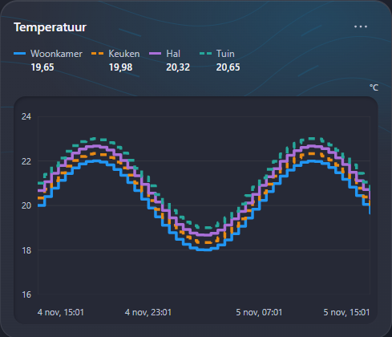
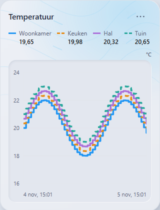
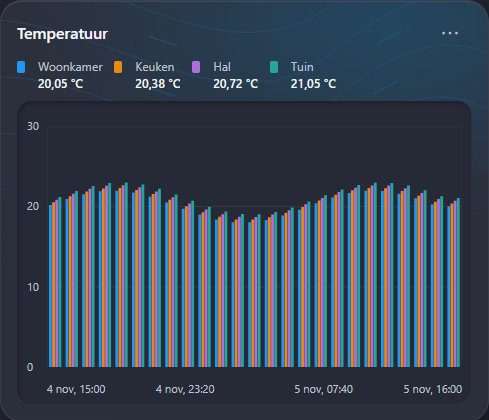
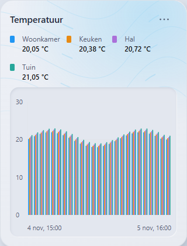

# Issue #14 - rendered fix evidence

Production-card screenshots with fictional sensor/calendar data, taken in Chrome after the fix. Wide uses the dark Material theme; narrow uses the light Material theme. No live Home Assistant connection or household data.


Reproduce with Node.js 22+, Chrome, and a current collection build. Screenshot capture is opt-in:

```powershell
$env:QA_SCREENSHOTS='1'; $env:QA_ISSUE='14'
node tests/capture-calendar-review.mjs
```

## Graph and Bar Chart

The same wrapping layout also applies to Graph and Bar Chart. Four short names fit on a wide row; narrow cards wrap entries according to their actual width. Values, shared/per-sensor units, long names, toggling and Shift+Enter isolation are preserved.









Reproduce with the same opt-in environment variables:

```powershell
node tests/browser-chart-legend-layout.mjs
```

Without screenshot opt-in, this runner only checks layout and interactions at 489/320/180 px, including long names/values and mixed units. Offline fixture checks do not constitute live Home Assistant verification.
