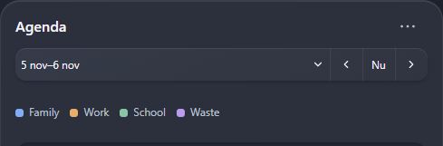
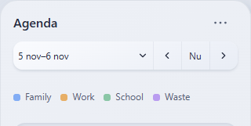

# Issue #14 - rendered fix evidence

Two production-card screenshots with fictional sensor/calendar data, taken in Chrome after the fix. Wide uses the dark Material theme; narrow uses the light Material theme. No live Home Assistant connection or household data.





Reproduce with Node.js 22+, Chrome, and a current collection build. Screenshot capture is opt-in:

```powershell
$env:QA_SCREENSHOTS='1'; $env:QA_ISSUE='14'
node tests/capture-calendar-review.mjs
```
